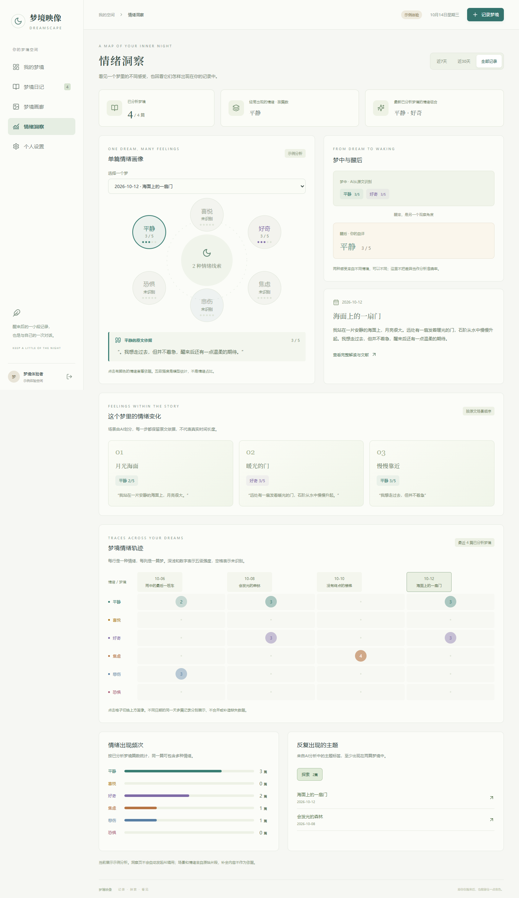

# 梦境映像项目介绍

梦境映像是梦境记录、AI辅助阅读与视觉创作课程作品。选题灵感来自《梦的解析》及梦境文化内容，希望提供记录片段、探索情绪和视觉表达的趣味体验。目标人群是对梦境与自我探索感兴趣的用户，这属于初步设想，尚未开展用户访谈。

## 个人贡献与AI协作

杨政提出选题，体验生成的作品并提出修改需求，由Codex完成代码实现。个人贡献是选题、体验反馈和需求修订。下列案例依据本人保留的修改指令整理；本人尚未记录逐项手工验收过程，作品的工具测试与个人验收分别说明。

## 三项实际修改需求

| 体验中发现的问题 | 本人提出的需求 | 当前作品呈现 |
| --- | --- | --- |
| 注册页缺少密码确认和可见控制 | 增加确认密码输入框及点击显示密码的图标 | 注册界面有确认密码、密码显示控制，前后端检查密码一致 |
| 情绪页主要使用醒后自评，与期待的原文分析有差距 | 希望AI依据梦境片段分析多种情绪，并丰富情绪可视化 | 作品区分梦中情绪和醒后自评，展示原文证据、单篇画像、场景变化与历史矩阵 |
| 设置页缺少实用功能 | 要求设置页增加实际可用的操作 | 当前提供昵称与密码修改、偏好设置、记录导出等功能 |

本人还提出梦境可手动命名、留空时AI命名，以及结合文献丰富梦境解读、现实背景关联与建议。具体界面和代码方案由Codex完成，不能将所有实现细节自动归为本人独立设计。

## 一项需求如何变得更清楚

本人指出：“情绪页完全就是根据用户自己选的醒后情绪感受来的”，希望改成由AI结合用户输入的梦境片段识别不同情绪。这是一项明确的产品方向修订：梦境原文作为分析输入，醒后自评作为对照。

当前代码进一步设置原文证据过滤，区分示例与正式模式。界面中的情绪对照和证据展示是作品现状；不能据此声称已证明模型准确率，或者本人独立制定了全部技术验证规则。

## 产品路径

记录原始梦境 → 可选整理或创意补全 → 用户确认补全 → 阅读情绪与意象 → 查看检索文献 → 选择画风和文本来源 → 查看视觉结果 → 回看情绪历史。

## 作品边界与验证

- 趣味记录与探索是本作品的定位，文献不能证明某个梦境意象必然对应某种个人含义。
- AI补全不能恢复真实记忆，梦境解读和情绪可视化不能用于心理诊断。
- 示例模式使用预置内容与规则；正式模式另需MySQL和模型服务配置。
- 发布副本构建、17项既有测试及桌面和390px手机浏览器检查由整理工具完成，不能写成作者亲自编写并执行全部测试。
- 本次未调用付费模型与生图接口，真实输出质量仍待验收。个人手工检查结果也尚未整理。

